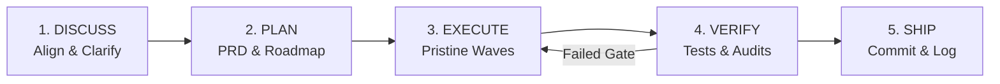

# Get Shit Done (GSD) — Spec-Driven Agent Engineering

> **"Context rot kills agent reliability. Structure, specs, and clean waves ensure flawless execution."**

`gsd-core` adapts the open-source **Get Shit Done** framework (`open-gsd` / `gsd-build`) specifically for Google Antigravity. It eliminates context degradation, hallucinatory drift, and skipped steps by forcing a structured, file-backed 5-phase delivery loop.

---

## When to Activate This Skill

Activate `gsd-core` when:
- The task spans multiple files, endpoints, or complex architectural changes.
- The user requests a large feature, overhaul, migration, or end-to-end implementation.
- Previous agent attempts suffered from "context rot" (repeating mistakes, losing track of requirements, partial edits).
- The user explicitly asks to "use GSD", "work in waves", or "follow spec-driven development".

---

## The 5-Phase GSD Lifecycle

### Phase 1: Discuss & Clarify (Before Writing Code)
Never jump directly into editing code on non-trivial tasks.
1. **Analyze Constraints**: Read existing codebase standards, models, and dependencies.
2. **Surface Ambiguities**: Identify edge cases, breaking changes, or user UX choices.
3. **Align with User**: Ask targeted questions (using `ask_question` or direct concise inquiries) before committing to a design.

### Phase 2: Plan & Spec (File-Backed Architecture)
Create or update the GSD triad in the project or artifacts directory:
- **`PRD.md`**: What is being built, user stories, acceptance criteria, and non-goals.
- **`ROADMAP.md`**: Breakdown of discrete waves with hard dependency order.
- **`STATE.md`**: Living document tracking current wave, completed items, active blockers, and decisions made.

Templates:
- [`PRD.template.md`](./resources/PRD.template.md)
- [`ROADMAP.template.md`](./resources/ROADMAP.template.md)
- [`STATE.template.md`](./resources/STATE.template.md)

### Phase 3: Execute in Pristine Waves
Execute tasks in **deterministic waves** rather than all at once:
1. **Wave Sizing**: Each wave contains 1 to 3 atomic tasks that can be fully implemented and verified within a clean context window.
2. **Subagent Delegation**: For large parallel waves, launch subagents (`invoke_subagent`) with isolated workspaces (`branch` or `inherit`), giving each a tight, specific prompt and clean context.
3. **No Unfinished Stubs**: Every wave must leave the repository in a compiling, syntactically valid state.

### Phase 4: Verify & Stress Test (Strict Quality Gate)
Never declare a task done based on assumptions. Execute the verification triad:
1. **Static Analysis**: Run TypeScript typechecking (`tsc --noEmit`).
2. **Automated Tests**: Run unit and integration tests (`vitest run`, `jest`, `playwright`).
3. **Production Build Check**: Verify that Next.js or framework builds cleanly (`next build`).
4. **Behavioral Boundary Checks**: Validate edge cases (empty states, errors, rate limits, responsive layouts).

If any check fails, immediately pause, debug root causes (using Debug Mode), and re-verify before proceeding.

### Phase 5: Ship & Clean Up
1. **Atomic Git Commit**: Commit changes with clean conventional commit syntax (`feat(...)`, `fix(...)`, `refactor(...)`).
2. **Update `STATE.md`**: Check off completed milestone, log changes, and update next steps.
3. **Report to User**: Give a concise, bulleted summary of verified accomplishments and immediate next options.

---

## Core Rules & Invariants

1. **Specs are Source of Truth**: When requirements change, update `PRD.md` first, then code.
2. **Zero Regressions**: Existing passing tests must remain passing. Run regression suites after every wave.
3. **Context Economy**: When conversation context gets long, summarize to `STATE.md` and recommend `/compact` or delegate next waves to fresh subagents.
4. **No Premature Victory**: A wave is only complete when tests pass, typechecks pass, and files are saved.

---

## Quick Reference

| Phase | Core Action | Artifact / Output |
| :--- | :--- | :--- |
| **1. Discuss** | Clarify scope & trade-offs | Alignment summary / decision log |
| **2. Plan** | Write spec & roadmap | `PRD.md`, `ROADMAP.md`, `STATE.md` |
| **3. Execute** | Code in atomic waves | Clean, idiomatic source edits |
| **4. Verify** | Run test & build gates | Typecheck & test run outputs (100% green) |
| **5. Ship** | Commit & record progress | Git commit & updated `STATE.md` |

