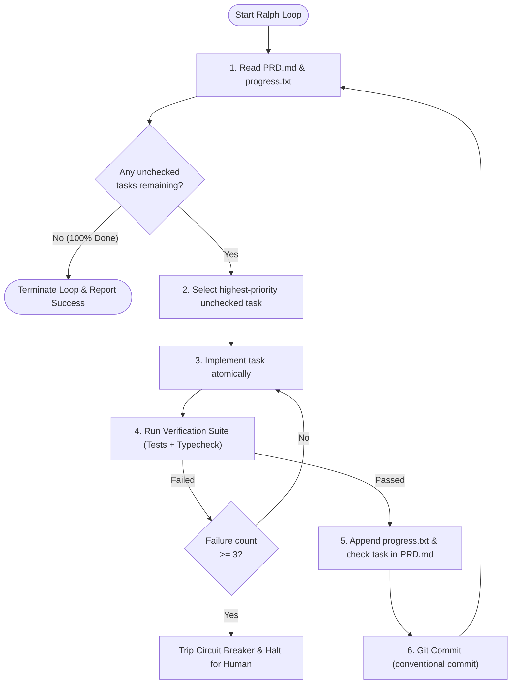

# Ralph Loop for Antigravity — Autonomous Continuous Agent Execution

> **"Fresh context per iteration. Externalized memory in files. Autonomous progress until every checkmark turns green."**

`ralph-loop` adapts the renowned **Ralph Wiggum autonomous agent loop** (`abhishekbhakat/ralph-loop-for-antigravity`) specifically for Google Antigravity. It allows the agent to execute long-running, multi-step coding objectives end-to-end without constant human babysitting by treating the filesystem (`PRD.md`, `progress.txt`, and git history) as its persistent memory bank.

---

## When to Activate This Skill

Activate `ralph-loop` when:
- The user requests: "Run in a loop", "Execute this autonomously", "Work on this overnight / until done", or invokes `/goal`.
- A project has a comprehensive task list (e.g., 5–15 distinct tasks) that needs sequential execution.
- You need to guarantee that long-running tasks don't degrade in quality due to conversation context window limits.
- The user wants automated git commits and progress tracking per task.

---

## The Ralph Loop Architecture



---

## File-System-First Memory Protocol

Traditional agents fail over long tasks because they rely on chat history. Ralph Loop relies on three physical files on disk:

1. **`PRD.md` (or `TASKS.md`)**:
   Contains the feature spec and an ordered checklist of discrete, testable items:
   ```markdown
   - [ ] Task 1: Create validation schema and types
   - [ ] Task 2: Implement API endpoint with database query
   - [ ] Task 3: Build frontend component with loading state
   ```
2. **`progress.txt`**:
   An append-only execution journal logging every completed iteration:
   ```text
   [2026-11-06T19:30:00Z] [TASK-1] COMPLETED: Implemented ServiceCreateSchema in src/lib/validations/tariff.ts. Tests: 126/126 passed. Commit: a1b2c3d
   ```
3. **Git History**:
   Every successful iteration produces a clean git commit. If an iteration breaks something irreparably, the agent can `git checkout` back to the last known good commit.

---

## The 6-Step Iteration Execution Protocol

For each iteration in the loop:

### Step 1: Read State
Read `PRD.md` and `progress.txt` to find where the loop left off. Never guess what was already done.

### Step 2: Pick the Next Atomic Task
Pick **exactly one** task from the checklist. Do not attempt multiple checklist items in a single iteration.

### Step 3: Implement Atomically
Make the targeted code changes for that specific task. Avoid touching unrelated files or making unsolicited stylistic modifications.

### Step 4: Verification Gate (Zero Compromise)
Run the project's automated verification commands:
```bash
npm run typecheck
npx vitest run
```
If verification fails:
- Inspect error logs.
- Apply a targeted fix.
- Re-run verification.
- **Circuit Breaker**: If the same task fails 3 consecutive times, pause the loop, log the failure to `progress.txt`, and report the blocker to the user rather than entering an infinite retry loop.

### Step 5: Update External Memory
- In `PRD.md`: Change `- [ ]` to `- [x]` for the completed task.
- In `progress.txt`: Append a single log entry formatted with timestamp, task ID, summary of changes, and test results.

### Step 6: Git Commit
Commit the changes using standard conventional commits:
```bash
git add <modified-files> PRD.md progress.txt
git commit -m "feat(module): [Task Description] - verified"
```

### Step 7: Repeat or Finish
Check if any unchecked tasks remain in `PRD.md`. If tasks remain, loop back to Step 1. If all tasks are checked, break the loop and present the final accomplishment summary.

---

## Safety Bounds & Guardrails

1. **Max Iterations Limit**: Set a hard cap (default: **10 iterations** per invocation) to prevent runaway processes.
2. **Circuit Breaker**: 3 consecutive failures on the same task immediately halts execution.
3. **Emergency Stop**: If the user sends a message, or says "stop", "pause", or cancels the schedule, immediately halt the loop and persist current state to `progress.txt`.
4. **Clean Builds Only**: Never commit changes if tests or builds are failing.

---

## Templates & Tooling

- [`PRD.template.md`](./resources/PRD.template.md): Standard checklist format for Ralph Loop.
- [`progress.template.txt`](./resources/progress.template.txt): Append-only log template.
- [`scripts/run-ralph.ps1`](./scripts/run-ralph.ps1): Automated loop execution script.

